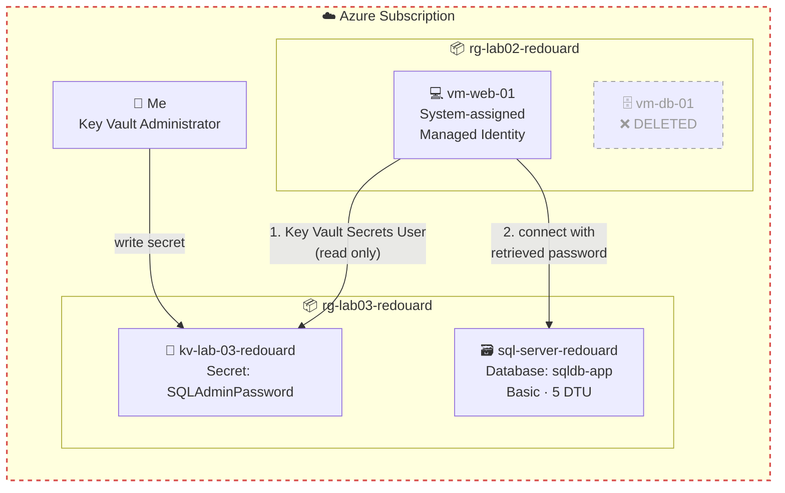
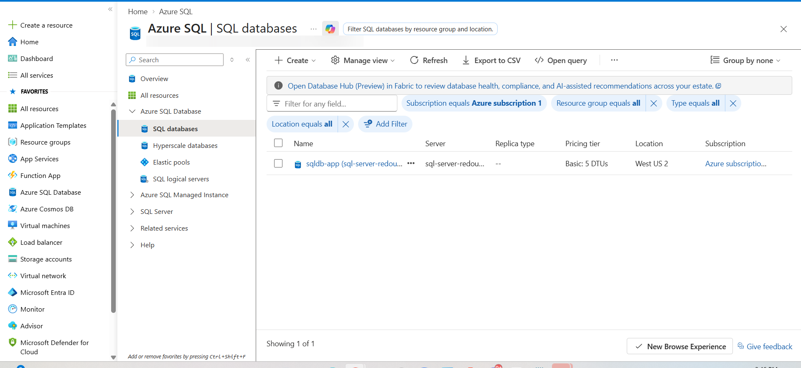
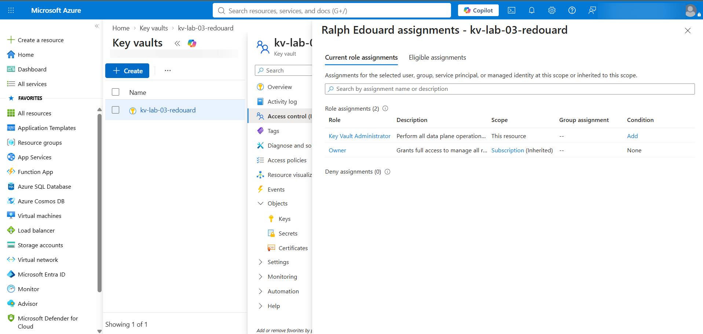
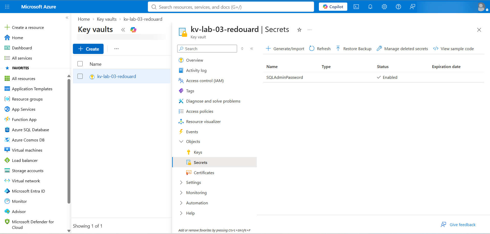
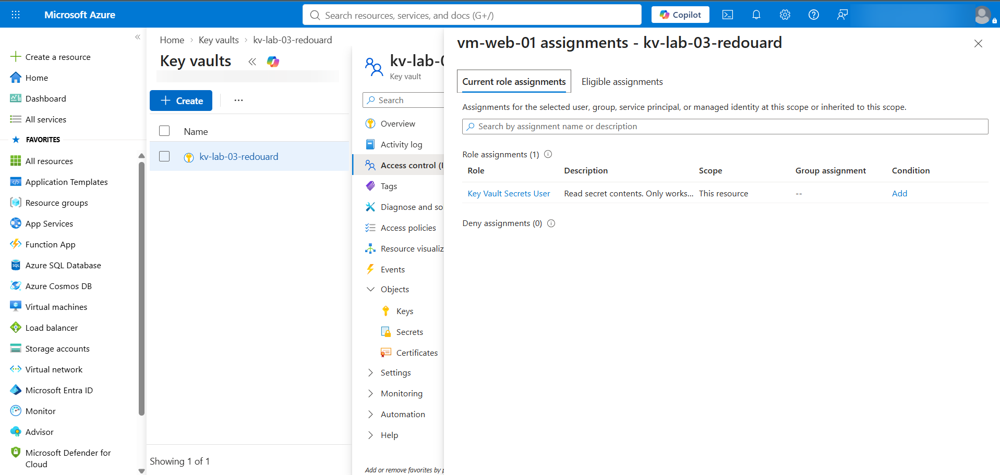
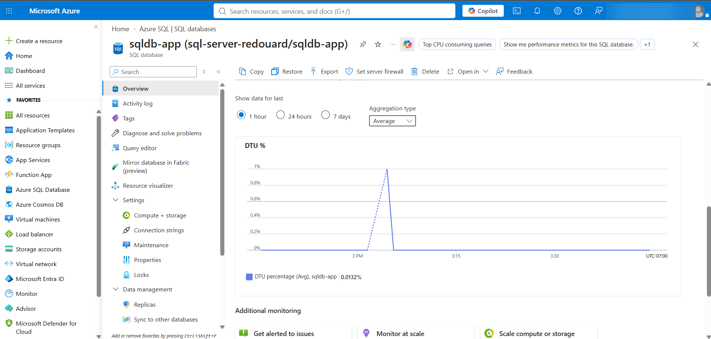
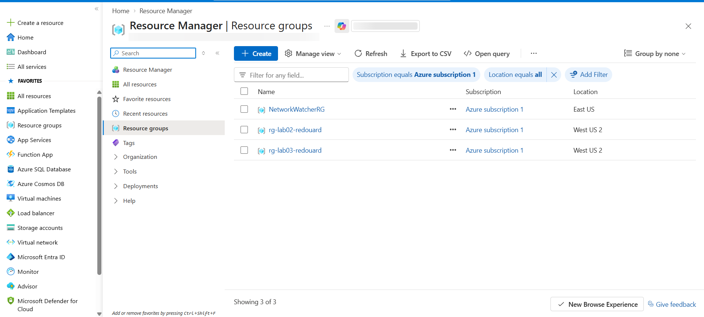

# Azure PaaS Migration + Key Vault Lab

> **The Build Log — Lab 003 of 12**
> *Replace a database VM with a managed database. Put the password in Key Vault. Let the web server fetch it with an identity instead of a credential.*

> **Author:** Ralph Edouard II
> **Series:** The Build Log — Azure Fundamentals
> **Status:** ✅ Completed

---

## 🙏 Credit

Lab 003 is part of a structured Azure curriculum **Jhante Charles** built for me to accelerate my Cloud Security Engineer transition. The lab design and instructions are his. The execution, walkthrough video, architecture diagram, security analysis, and writeup are mine.

---

## 🎬 Watch Me Build This Lab

[**▶ Lab 03 — Azure SQL Database, Key Vault, and Managed Identity**](https://www.loom.com/share/7e6cc4de8ef7442bbefbcd3261070d2b)

Builds on [Lab 002](https://github.com/redouard2/azure-2tier-vnet-lab) — `vm-web-01` from that lab is the web server here.

---

## 👋 About This Lab

Lab 002 built a database *server*. Lab 003 deletes it.

Not because it was wrong — because in the real world, a VM running a database is a server you patch, back up, and babysit. This lab swaps it for Azure SQL Database, where Microsoft does all of that, and then solves the problem that swap creates: the web server now needs a password to reach the database, and that password has to live somewhere.

The answer is Key Vault plus a Managed Identity. The web VM gets an identity of its own, that identity gets read-only access to one secret, and the password is never typed into code, a config file, or the server. That's the whole lab.

Coming from SysAdmin work, this is the one where cloud stopped feeling like "servers somewhere else" and started feeling like a different model.

---

## 📌 What I Built

- Decommissioned `vm-db-01` (and its disk and NIC) from Lab 002
- **Azure SQL Database** `sqldb-app` on a logical server `sql-server-redouard` — Basic tier, 5 DTUs
- **Azure Key Vault** `kv-lab-03-redouard` using the RBAC permission model
- A secret, `SQLAdminPassword`, holding the SQL admin password
- A **system-assigned Managed Identity** on `vm-web-01`
- Two RBAC role assignments on the vault — one for me, one for the VM — with different permissions on purpose
- Azure Monitor metrics on the database to confirm it's live

---

## 🏗️ Architecture

The flow: `vm-web-01` presents its Managed Identity to Key Vault. Key Vault checks RBAC, sees the identity holds **Key Vault Secrets User**, and returns the secret. The VM uses it to reach Azure SQL. At no point is the password stored on the VM or in anything the VM runs.

Two principals, two roles:

| Who | Role on the vault | Can do |
| --- | --- | --- |
| Me | Key Vault Administrator | Create, read, update, delete secrets |
| `vm-web-01` | Key Vault Secrets User | Read secret values. Nothing else. |

I need the first because I'm setting up the vault. The VM only ever needs the second. That gap is least privilege.

---

## 🎯 What I Practiced

- Decommissioning a VM cleanly — the VM, its OS disk, and its NIC, not just the VM
- Deploying Azure SQL Database and understanding server vs. database
- Navigating the portal's free-offer banner to land on the Basic DTU tier instead of Serverless
- Deploying Key Vault with RBAC as the permission model
- Storing a secret and verifying Key Vault hides the value after storage
- Enabling a system-assigned Managed Identity on an existing VM
- Writing two RBAC role assignments scoped to a single resource
- Reading Azure Monitor metrics on a PaaS resource — and knowing what to check when Monitor itself fails

---

## ✅ What You'll Need

| Requirement | Notes |
| --- | --- |
| Active Azure subscription | Free Tier works |
| Lab 002 completed | `vm-web-01` must exist and be running in `rg-lab02-<yourname>` |
| About 60 minutes | Plus a few minutes of waiting on Azure |

---

## 🧾 Naming Convention

| Resource | Name | Notes |
| --- | --- | --- |
| Resource Group | `rg-lab03-<yourname>` | I used `rg-lab03-redouard` |
| Region | `West US 2` | Same as my Lab 002 resources. Keep everything in one region. |
| SQL Server | `sql-server-<yourname>` | Globally unique, all lowercase |
| SQL Database | `sqldb-app` | Exact name |
| Key Vault | `kv-lab-03-<yourname>` | Globally unique |
| Secret | `SQLAdminPassword` | Letters, numbers, hyphens only |
| SQL admin login | `sqladmin` | — |

> 💡 **Why globally unique?** SQL servers and Key Vaults get a public DNS name (`sql-server-redouard.database.windows.net`, `kv-lab-03-redouard.vault.azure.net`). Two resources anywhere in Azure can't share one.

---

## 🛠️ How I Built It

### Phase 1 — Decommission the Database VM

1. **Resource groups** → `rg-lab02-<yourname>`.
2. Select three resources: `vm-db-01`, its OS disk (`vm-db-01_OsDisk_...`), and its NIC (`vm-db-01-nic` or similar).
3. **Delete** → type `delete` → confirm.

> ⚠️ Do **not** delete the resource group or `vm-web-01`. If you're unsure which disk or NIC belongs to the DB VM, open it — the Overview shows the attached VM.

> **Why delete instead of stop?** A stopped VM still bills for its managed disk and reserved IP. Delete is the correct decommission.

### Phase 2 — Deploy Azure SQL Database

1. Search **SQL databases** (not SQL servers) → **+ Create** dropdown → **SQL database** (not the Free offer).
2. If a green **"Free offer applied"** banner appears, click **Remove offer** and wait for the page to reload. The Basic DTU tier doesn't exist until that banner is gone.
3. **Basics:**
   - Resource group: **Create new** → `rg-lab03-<yourname>`
   - Database name: clear the auto-filled name, enter `sqldb-app`
   - Server: **Create new** → name `sql-server-<yourname>`, region `West US 2`, **Use SQL authentication**, login `sqladmin`, strong password — **write it down**
   - Elastic pool: **No**
   - Workload environment: **Development** (Production defaults to Hyperscale at $320+/month)
   - Compute + storage → **Configure database** → **DTU-based** → **Basic** → confirm ~$4.99/month
   - Backup storage redundancy: **LRS**
4. **Networking:** Connectivity method **Public endpoint** → Allow Azure services **Yes** → Add current client IP **Yes** → Minimum TLS **1.2**.
5. **Security:** Microsoft Defender for SQL → **Not now** ($15/server/month; skip for a lab).
6. **Review + create** → confirm tier shows **Basic** → **Create**.

### Phase 3 — Deploy Key Vault

1. Search **Key vaults** → **+ Create**.
2. **Basics:** resource group `rg-lab03-<yourname>`, name `kv-lab-03-<yourname>`, region `West US 2`, pricing tier **Standard**.
3. **Recovery options:** leave soft-delete at 90 days, leave **purge protection disabled** (enabling it blocks cleanup for 90 days).
4. **Access configuration:** permission model **Azure role-based access control** — leave the three resource-access checkboxes unchecked.
5. **Networking:** public access enabled, all networks.
6. **Review + create** → **Create**.

**Then grant yourself access.** With RBAC, nobody can read the vault by default — including you. Open the vault → **Access control (IAM)** → **+ Add role assignment** → **Key Vault Administrator** → assign to your own account. Wait a minute or two.

### Phase 4 — Store the Password

1. Vault → **Objects → Secrets** → **+ Generate/Import**.
2. Name `SQLAdminPassword`, value = the SQL admin password from Phase 2. Leave everything else default.
3. **Create.**

Click the secret, then its version — you'll see metadata but not the value. That's intentional.

### Phase 5 — Managed Identity + RBAC

**Part A — give the VM an identity.**
`rg-lab02-<yourname>` → `vm-web-01` → **Identity** → **System assigned** → Status **On** → **Save** → **Yes**. An Object (principal) ID appears. That's the VM's identity in Entra.

**Part B — give the identity access to the vault.**
Vault → **Access control (IAM)** → **+ Add role assignment** → **Key Vault Secrets User** → **Next** → Assign access to **Managed identity** → **+ Select members** → Managed identity: **Virtual machine** → pick `vm-web-01` → **Review + assign**.

> **Why a different role than mine?** Key Vault Administrator can do everything. Key Vault Secrets User can only read secret values. The VM needs to read one password. That's all it gets.

### Phase 6 — Validate with Azure Monitor

`sqldb-app` → **Monitoring → Metrics** → Metric **DTU percentage**, Aggregation **Max**. A line appears — even near zero, it means the database is alive and being monitored.

This is where I lost time. See below.

### Phase 7 — Cleanup

Delete `rg-lab03-<yourname>`. Delete `rg-lab02-<yourname>` too.

> `NetworkWatcherRG` is Azure's. It gets created automatically when you make a VNet and costs nothing. Leave it.

---

## 🔐 Security Things I Noticed

Still early on the cloud security side. Observations, not expert guidance:

- **The password never touches the web server.** That's the point of the lab, and it's the pattern behind every "no secrets in code" policy I've ever read. Key Vault + Managed Identity is how it's actually done.
- **Two roles, two scopes.** I hold Key Vault Administrator because I'm building the vault. The VM holds Key Vault Secrets User because it only reads. Least privilege isn't a principle here — it's two rows in an IAM blade.
- **There's still a password.** The lab uses SQL authentication, so a credential exists and Key Vault guards it. The stronger pattern is **Entra-only authentication** on the SQL server with the VM's Managed Identity granted directly on the database — then there's no password to store at all. Jhante's doc picks SQL auth to keep the lab focused. A later lab should close that gap.
- **"Allow Azure services and resources to access this server" is broader than it sounds.** It allows traffic from *any* Azure tenant's services, not just mine. For a lab, fine. For production: Private Endpoint, or at minimum a VNet rule scoped to `snet-web`.
- **Key Vault is on all networks.** RBAC still gates access, but the vault's public endpoint is reachable from anywhere. Production answer is the same — Private Endpoint.
- **Defender for SQL is off.** $15/month is the right call for a lab and the wrong call for anything real.
- **Purge protection is off.** Correct for a lab I'm tearing down. In production, enabling it means a deleted vault can't be permanently purged during the retention window — which is what you want when the vault holds the keys to everything.
- **Still no diagnostic logging** on the vault or the database. Three labs in, this is the thread I keep pulling and not finishing. Noted.

---

## 💰 What This Cost

Basic-tier SQL Database is ~$4.99/month, billed hourly. Key Vault Standard is fractions of a cent per operation. For the few hours this ran: well under a dollar.

The real cost risk on this lab is the **workload environment** dropdown defaulting to Production. That's Hyperscale, $320+/month. Jhante's doc calls it out; so will I.

---

## 🧰 Stuff That Tripped Me Up

**DTU percentage was in the metrics dropdown. Then it wasn't. Then the chart said "Error retrieving data."**

I'd done everything right — Basic tier, database Online. And the metric I was supposed to validate with vanished from the dropdown and the chart threw an error.

What was actually happening: Azure Monitor builds that metric list from whatever the resource has published, and a brand-new database hasn't published much. Monitor was the thing failing, not the database. I confirmed that by going back to the Overview blade — **Status: Online, Pricing tier: Basic** — and waiting. The metric came back on its own and rendered fine.

The lesson isn't "wait longer." It's **check the resource before you trust the thing watching the resource.** An error on a dashboard is not the same as an error in the system.

**The free-offer banner hides the Basic tier.**
Until you click **Remove offer** and the page reloads, Configure database only shows Serverless. If you deploy on Serverless by accident, don't try to change the tier afterward — the vCore options on that page can cost $400+/month. Use CPU percentage in Phase 6 instead and move on.

**You can't read your own Key Vault.**
RBAC model means no one has data-plane access at creation, including the creator. "You are unauthorized to view these contents" on a vault you made ten seconds ago is expected. Assign yourself Key Vault Administrator and wait a minute.

**Database name vs. server name.**
Two different fields, two different things. The database field auto-fills with junk — clear it and type `sqldb-app`. Azure can't rename a database after creation.

---

## 🧠 What I Took Away

- "Managed" means I stopped owning the OS, the patches, and the backups. It doesn't mean I stopped owning the firewall rules, the identity model, or the secret.
- A Managed Identity is the cloud answer to "where do I put the service account password." The answer is: there isn't one.
- Two role assignments on one resource taught me more about least privilege than any slide ever did.
- Observability has its own failure modes. When the monitor errors, check the thing being monitored before you touch anything.
- Lab 002's database server lasted two weeks. Deleting your own work on purpose is part of the job.

---

## 📚 References

- [Azure SQL Database — Microsoft Learn](https://learn.microsoft.com/azure/azure-sql/database/sql-database-paas-overview)
- [Azure Key Vault RBAC guide — Microsoft Learn](https://learn.microsoft.com/azure/key-vault/general/rbac-guide)
- [Managed identities for Azure resources — Microsoft Learn](https://learn.microsoft.com/entra/identity/managed-identities-azure-resources/overview)
- [Key Vault built-in roles — Microsoft Learn](https://learn.microsoft.com/azure/role-based-access-control/built-in-roles#key-vault-secrets-user)
- [Entra authentication for Azure SQL — Microsoft Learn](https://learn.microsoft.com/azure/azure-sql/database/authentication-aad-overview)

---

## 🗺️ The Build Log Series

- [Lab 001 — Azure Static Website Hosting](https://github.com/redouard2/azure-static-website-lab)
- [Lab 002 — Two-Tier Web Application](https://github.com/redouard2/azure-2tier-vnet-lab)
- **Lab 003 — PaaS Migration + Key Vault** ← *you are here*
- Lab 004 — *coming soon*

---

*Part of my Cloud Security Engineer transition. Writing these up the way I'd want them written for me.*
